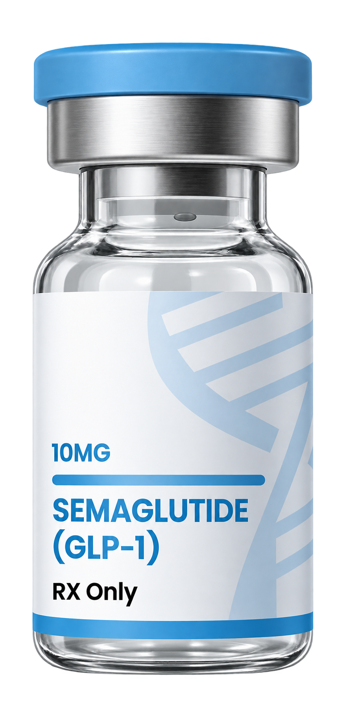

# LycheMD Theme & Page Template Guide

Welcome to the **LycheMD** design system and website template guide. This document serves as the master blueprint for creating new pages, sections, and components matching the exact luxury telehealth, clinical wellness, and longevity aesthetic of LycheMD.

---

## Table of Contents
1. [Brand Identity & Core Principles](#1-brand-identity--core-principles)
2. [Design Tokens & Color Palette](#2-design-tokens--color-palette)
3. [Typography System & Editorial Accents](#3-typography-system--editorial-accents)
4. [Sizing, Spacing & Rem Scale](#4-sizing-spacing--rem-scale)
5. [Page Head & Script Setup](#5-page-head--script-setup)
6. [Universal Navigation (Header & Offcanvas)](#6-universal-navigation-header--offcanvas)
7. [Hero Section Patterns](#7-hero-section-patterns)
8. [Buttons, Badges & UI Elements](#8-buttons-badges--ui-elements)
9. [Product Cards & Showcase Grids](#9-product-cards--showcase-grids)
10. [Category Tabs & 2-Row Pagination](#10-category-tabs--2-row-pagination)
11. [Standard Content Sections](#11-standard-content-sections)
    - [How It Works (Steps Section)](#how-it-works-steps-section)
    - [Expert Telehealth Care Banner](#expert-telehealth-care-banner)
    - [Testimonials & Reviews Marquee](#testimonials--reviews-marquee)
    - [Accordion FAQs](#accordion-faqs)
    - [Global Site Footer](#global-site-footer)
12. [Interactive JavaScript Architecture](#12-interactive-javascript-architecture)
13. [Ready-to-Use Starter HTML Template](#13-ready-to-use-starter-html-template)

---

## 1. Brand Identity & Core Principles

* **Brand Name:** **LycheMD**
* **Aesthetic:** Modern, clinical, premium telehealth with a warm editorial touch.
* **Mood:** Trustworthy, discrete, sophisticated, medically backed.
* **Layout:** Generous white space, pill-shaped buttons, subtle rounded card containers (`border-radius: 2.2rem`), micro-interactions, and fluid typography.

---

## 2. Design Tokens & Color Palette

The template uses clean CSS custom properties and standardized color codes across all pages:

```css
:root {
    /* Brand Colors */
    --color-primary-slate: #4c6881;       /* Primary brand button / active tab background */
    --color-primary-slate-hover: #38556f; /* Darker slate for hover & focus */
    --color-accent-gold: #fed368;         /* High-conversion accent yellow (Hero CTAs) */
    --color-accent-gold-hover: #e5bd57;   /* Hover state for yellow button */

    /* Dark Neutrals */
    --color-text-dark: #17252d;           /* Primary text / deep navy headings */
    --color-text-subtle: #4b5563;         /* Body copy & descriptions (gray 600) */
    --color-text-muted: #64748b;          /* Metadata, hints & subtitle text (slate 500) */
    --color-dark-bg: #070b0f;             /* Dark luxury hero / page loader background */

    /* Light Neutrals & Clinical Backgrounds */
    --color-bg-page: #ebf5ff;             /* Signature ice blue page background */
    --color-bg-subtle: #f8fbfe;           /* Soft card & pane background */
    --color-bg-white: #ffffff;            /* Pure card & container white */

    /* Borders & Badges */
    --color-border: #e2e8f0;              /* Standard clean border */
    --color-border-card: #e5e7eb;         /* Subtle card outlines */
    --color-badge-bg: #e0f2fe;            /* GLP-1 and clinical treatment badge background */
    --color-badge-text: #0284c7;          /* Clinical badge blue text */
    --color-rating-gold: #f59e0b;         /* Trust & review star rating gold */
}
```

### Color Usage Guidelines
| Element | Primary Color | Hex |
| :--- | :--- | :--- |
| **Hero CTA Button** | Vibrant Gold / Yellow | `#fed368` (text: `#17252d`) |
| **Card Action ("Get Started")** | Solid Slate Blue | `#4c6881` (hover: `#38556f`, text: `#ffffff`) |
| **Ghost Action ("Learn more")** | White / Outline | Border `#d1d5db`, text `#4b5563` |
| **Active Tabs & Filters** | Solid Slate Blue | `#4c6881` with white icon (`invert(1)`) |
| **Treatment Badges** | Soft Cyan / Light Blue | `#e0f2fe` (text: `#0284c7` or `#0369a1`) |
| **Background Fill** | Ice Blue Tint | `#ebf5ff` or `#ffffff` |

---

## 3. Typography System & Editorial Accents

Three high-quality Google Fonts define the typography:
1. **Display & Editorial Accents:** `'Playfair Display', Georgia, serif`
2. **Primary Sans (Headings & UI):** `'Plus Jakarta Sans', sans-serif`
3. **Body & Utility Sans:** `'DM Sans', sans-serif`

### The Signature Editorial Italic Pattern
Every major section title pairs modern bold sans or clean serif with an italic serif phrase:
```html
<!-- Example 1: Editorial Serif Headline -->
<h2 class="section-title">
    What <em>would you</em> like help with?
</h2>

<!-- Example 2: Treatment Headline -->
<h2 class="section-title">
    Explore our <em>most popular</em> treatments
</h2>

<!-- Example 3: Hero Headline -->
<h1 class="hero-title">
    Personalized wellness for a <em>healthier, happier</em> You
</h1>
```

---

## 4. Sizing, Spacing & Rem Scale

The stylesheet uses a **62.5% root scale** (`1rem = 10px`), making spacing and typography intuitive:

* `1.2rem` = `12px` (badges, small labels)
* `1.4rem` = `14px` (subtitles, secondary copy, input hints)
* `1.6rem` = `16px` (base body text, standard button labels)
* `1.8rem` = `18px` (large card titles, callouts)
* `2.2rem` = `22px` (card headings)
* `3.2rem` = `32px` (h3 / subheadings)
* `4.2rem` – `5.6rem` = section headlines (`clamp(3.2rem, 3.6vw, 5.2rem)`)

---

## 5. Page Head & Script Setup

Every page must include the following boilerplate in `<head>` and before `</body>`:

### Standard `<head>` Includes
```html
<!DOCTYPE html>
<html lang="en">
<head>
    <meta charset="UTF-8">
    <meta name="viewport" content="width=device-width, initial-scale=1.0">
    <title>Page Title — LycheMD</title>
    <meta name="description" content="Your page description here.">
    <meta name="theme-color" content="#ebf5ff">

    <!-- Favicon & Brand Icons -->
    <link rel="icon" type="image/svg+xml" href="Assets/images/favicon.svg">
    <link rel="icon" type="image/png" sizes="32x32" href="Assets/images/favicon-32x32.png">
    <link rel="icon" type="image/png" sizes="16x16" href="Assets/images/favicon-16x16.png">
    <link rel="apple-touch-icon" sizes="180x180" href="Assets/images/apple-touch-icon.png">
    <link rel="shortcut icon" href="favicon.ico">
    <link rel="manifest" href="site.webmanifest">

    <!-- Google Fonts -->
    <link rel="preconnect" href="https://fonts.googleapis.com">
    <link rel="preconnect" href="https://fonts.gstatic.com" crossorigin>
    <link href="https://fonts.googleapis.com/css2?family=DM+Sans:ital,opsz,wght@0,9..40,100..1000;1,9..40,100..1000&family=Playfair+Display:ital,wght@0,400..900;1,400..900&family=Plus+Jakarta+Sans:ital,wght@0,200..800;1,200..800&display=swap" rel="stylesheet">

    <!-- Bootstrap 5 CSS -->
    <link href="https://cdn.jsdelivr.net/npm/bootstrap@5.3.3/dist/css/bootstrap.min.css" rel="stylesheet" integrity="sha384-QWTKZyjpPEjISv5WaRU9OFeRpok6YctnYmDr5pNlyT2bRjXh0JMhjY6hW+ALEwIH" crossorigin="anonymous">

    <!-- LycheMD Main Stylesheet -->
    <link rel="stylesheet" href="Assets/css/style.css?v=3.5">
</head>
```

### Standard Scripts (Before `</body>`)
```html
    <!-- Bootstrap 5 Bundle JS -->
    <script src="https://cdn.jsdelivr.net/npm/bootstrap@5.3.3/dist/js/bootstrap.bundle.min.js" integrity="sha384-YvpcrYf0tY3lHB60NNkmXc5s9fDVZLESaAA55NDzOxhy9GkcIdslK1eN7N6jIeHz" crossorigin="anonymous"></script>

    <!-- GSAP 3 Animation Suite -->
    <script src="https://cdnjs.cloudflare.com/ajax/libs/gsap/3.12.5/gsap.min.js"></script>
    <script src="https://cdnjs.cloudflare.com/ajax/libs/gsap/3.12.5/ScrollTrigger.min.js"></script>
    <script src="https://cdnjs.cloudflare.com/ajax/libs/gsap/3.12.5/ScrollToPlugin.min.js"></script>

    <!-- Lenis Smooth Scrolling Engine -->
    <script src="https://cdn.jsdelivr.net/npm/lenis@1.1.18/dist/lenis.min.js"></script>

    <!-- LycheMD Main Script -->
    <script src="Assets/js/main.js?v=3.5"></script>
</body>
</html>
```

---

## 6. Universal Navigation (Header & Offcanvas)

The header utilizes a 3-part layout: Left Navigation, Centered Brand Title, and Right Utility Navigation.

```html
<header class="site-header" id="siteHeader" aria-label="Main Navigation">
    <div class="container">
        <!-- Desktop Navigation Grid -->
        <div class="header-inner d-none d-lg-grid">
            <!-- Left Nav Links -->
            <nav class="nav-group-left" aria-label="Main Navigation Left">
                <div class="nav-dropdown">
                    <a href="category.html" class="nav-link-custom" role="button" aria-expanded="false">
                        Treatments
                        <svg class="chevron-icon" width="10" height="6" viewBox="0 0 10 6" fill="none" xmlns="http://www.w3.org/2000/svg" aria-hidden="true">
                            <path d="M1 1L5 5L9 1" stroke="currentColor" stroke-width="1.4" stroke-linecap="round" stroke-linejoin="round" />
                        </svg>
                    </a>
                    <!-- Dropdown Menu -->
                    <div class="dropdown-menu-lychemd" role="menu">
                        <a href="category.html?category=weight-loss" class="dropdown-link-item" role="menuitem">
                            <span class="item-title">Weight Loss</span>
                            <span class="item-desc">Take control of your weight</span>
                        </a>
                        <a href="category.html?category=skin-hair" class="dropdown-link-item" role="menuitem">
                            <span class="item-title">Hair &amp; Skin</span>
                            <span class="item-desc">Radiant hair, healthy skin</span>
                        </a>
                        <a href="category.html?category=sexual-health" class="dropdown-link-item" role="menuitem">
                            <span class="item-title">Sexual Health</span>
                            <span class="item-desc">Reclaim your intimate moments</span>
                        </a>
                        <a href="category.html?category=hormone-health" class="dropdown-link-item" role="menuitem">
                            <span class="item-title">Menopause</span>
                            <span class="item-desc">Tackle your hormone changes</span>
                        </a>
                        <a href="category.html?category=longevity" class="dropdown-link-item" role="menuitem">
                            <span class="item-title">Sleep &amp; Longevity</span>
                            <span class="item-desc">Optimize cellular vitality</span>
                        </a>
                    </div>
                </div>
                <a href="#wellnessStepsSection" class="nav-link-custom">How It Works</a>
                <a href="#expertCareSection" class="nav-link-custom">Expert Care</a>
            </nav>

            <!-- Center Brand Logo -->
            <div class="nav-brand-center">
                <a href="index.html" class="brand-title" aria-label="LycheMD Homepage">LycheMD</a>
            </div>

            <!-- Right Nav Links -->
            <nav class="nav-group-right" aria-label="Main Navigation Right">
                <a href="index.html#careOptionsSection" class="nav-link-custom">Care Options</a>
                <a href="#faqSection" class="nav-link-custom">FAQs</a>
                <a href="#testimonialsSection" class="nav-link-custom">Reviews</a>
                <a href="login.html" class="nav-link-custom" id="loginNavLink">Login</a>
            </nav>
        </div>

        <!-- Mobile Navigation Bar -->
        <div class="header-mobile-bar d-flex d-lg-none">
            <a href="index.html" class="brand-title" aria-label="LycheMD Homepage">LycheMD</a>
            <button class="mobile-toggle-btn" type="button" data-bs-toggle="offcanvas" data-bs-target="#mobileMenu" aria-controls="mobileMenu" aria-label="Toggle navigation menu">
                <svg width="22" height="22" viewBox="0 0 24 24" fill="none" stroke="#ffffff" stroke-width="2" stroke-linecap="round" stroke-linejoin="round" aria-hidden="true">
                    <line x1="3" y1="6" x2="21" y2="6"></line>
                    <line x1="3" y1="12" x2="21" y2="12"></line>
                    <line x1="3" y1="18" x2="21" y2="18"></line>
                </svg>
            </button>
        </div>
    </div>
</header>

<!-- Mobile Offcanvas Menu -->
<div class="offcanvas offcanvas-end offcanvas-lychemd" tabindex="-1" id="mobileMenu" aria-labelledby="mobileMenuLabel">
    <div class="offcanvas-header">
        <h5 class="offcanvas-title brand-title" id="mobileMenuLabel">LycheMD</h5>
        <button type="button" class="btn-close btn-close-white text-reset" data-bs-dismiss="offcanvas" aria-label="Close menu"></button>
    </div>
    <div class="offcanvas-body">
        <ul class="mobile-nav-list">
            <li><a href="category.html" class="mobile-nav-item" data-bs-dismiss="offcanvas">Treatments <span>→</span></a></li>
            <li><a href="#wellnessStepsSection" class="mobile-nav-item" data-bs-dismiss="offcanvas">How It Works <span>→</span></a></li>
            <li><a href="#expertCareSection" class="mobile-nav-item" data-bs-dismiss="offcanvas">Expert Care <span>→</span></a></li>
            <li><a href="index.html#careOptionsSection" class="mobile-nav-item" data-bs-dismiss="offcanvas">Care Options <span>→</span></a></li>
            <li><a href="#faqSection" class="mobile-nav-item" data-bs-dismiss="offcanvas">FAQs <span>→</span></a></li>
            <li><a href="#testimonialsSection" class="mobile-nav-item" data-bs-dismiss="offcanvas">Reviews <span>→</span></a></li>
            <li><a href="login.html" class="mobile-nav-item">Login <span>→</span></a></li>
        </ul>
        <div class="mobile-nav-footer">
            <a href="category.html" class="btn-hero-cta w-100 justify-content-center" data-bs-dismiss="offcanvas">
                <span>Explore Treatments</span>
                
            </a>
        </div>
    </div>
</div>
```

---

## 7. Hero Section Patterns

### A. Full Background Editorial Hero (Homepage / Landing)
```html
<section class="hero-section" id="hero" aria-label="LycheMD Hero Introduction">
    <div class="hero-bg-container">
        
        <div class="hero-overlay"></div>
    </div>
    <div class="container hero-content-container">
        <div class="hero-content">
            <span class="hero-badge">Clinical Healthcare &amp; Longevity</span>
            <h1 class="hero-title">
                Personalized wellness for a <em>healthier, happier</em> You
            </h1>
            <p class="hero-description">
                Experience tailored, discrete medical care. Clinical protocols for metabolic longevity, bioidentical hormones, and dermatological vitality.
            </p>
            <div>
                <a href="category.html" class="btn-hero-cta">
                    <span>Explore Treatments</span>
                    
                </a>
            </div>
        </div>
    </div>
</section>
```

### B. Category Showcase Header
```html
<section class="cat-hero-section" aria-label="Treatments Directory">
    <div class="container text-center">
        <span class="cat-hero-badge">Medical Directory</span>
        <h1 class="cat-hero-title">Explore <em>all treatment</em> options</h1>
        <p class="cat-hero-subtitle">Clinically approved telehealth solutions prescribed by licensed medical providers.</p>
    </div>
</section>
```

---

## 8. Buttons, Badges & UI Elements

### 1. Hero Golden CTA Button (`.btn-hero-cta`)
```html
<a href="intake.html" class="btn-hero-cta">
    <span>Get Started</span>
    
</a>
```

### 2. Dual Action Group in Product Cards
```html
<div class="cat-card-btn-group">
    <!-- Ghost outline button -->
    <a href="semaglutide.html" class="cat-btn-learn-more">Learn more</a>
    <!-- Solid slate blue conversion button -->
    <a href="intake.html" class="cat-btn-get-started">Get Started</a>
</div>
```

### 3. Clinical Badges
```html
<!-- Category / Clinical Type Pill -->
<span class="cat-product-badge">GLP-1 Treatment</span>

<!-- Section Sub-headline Pill -->
<div class="section-tag-pill">HOW IT WORKS</div>
```

---

## 9. Product Cards & Showcase Grids

The standard 4-column product card is fully responsive (4 cols desktop, 2 cols tablet, 1 col mobile) with interactive hover micro-animations:

```html
<div class="cat-product-card" data-product="semaglutide-injection">
    <div class="cat-product-card-inner">
        <!-- Badge -->
        <div class="cat-card-header">
            <span class="cat-product-badge">GLP-1 Treatment</span>
        </div>

        <!-- Product Image Link -->
        <div class="cat-product-img-wrap">
            <a href="semaglutide.html" class="cat-product-img-link" aria-label="Semaglutide Injection details">
                
            </a>
        </div>

        <!-- Card Footer -->
        <div class="cat-card-footer">
            <h3 class="cat-product-title">
                <a href="semaglutide.html">Semaglutide Injection</a>
            </h3>
            <p class="cat-product-price">From $149/mo</p>

            <div class="cat-card-btn-group">
                <a href="semaglutide.html" class="cat-btn-learn-more">Learn more</a>
                <a href="intake.html" class="cat-btn-get-started">Get Started</a>
            </div>
        </div>
    </div>
</div>
```

---

## 10. Category Tabs & 2-Row Pagination

The category navigation system supports deep-linking, animated tab transitions, and pagination for large inventories:

```html
<section class="category-products-section" id="categoryProducts" aria-label="Treatment Categories and Products">
    <div class="container">
        <!-- Category Tabs Navigation -->
        <div class="cat-tabs-wrapper">
            <div class="cat-tabs-nav" role="tablist" aria-label="Treatment Categories">
                <button type="button" class="cat-tab-btn active" role="tab" id="catTabAll" aria-selected="true" aria-controls="paneAll" data-category="all">
                    <span class="cat-tab-icon-wrap" aria-hidden="true">
                        
                    </span>
                    <span class="cat-tab-label">All Treatments</span>
                </button>
                <button type="button" class="cat-tab-btn" role="tab" id="catTabWeightLoss" aria-selected="false" aria-controls="paneWeightLoss" data-category="weight-loss">
                    <span class="cat-tab-icon-wrap" aria-hidden="true">
                        
                    </span>
                    <span class="cat-tab-label">Weight Loss</span>
                </button>
            </div>
        </div>

        <!-- Tab Content Panes -->
        <div class="cat-tab-content-wrap">
            <div class="cat-tab-pane active" id="paneAll" role="tabpanel" aria-labelledby="catTabAll">
                <!-- 4 Columns x 2 Rows = 8 items per page -->
                <div class="cat-products-grid" id="allProductsGrid" data-current-page="1">
                    <!-- Cards with data-cat-page="1", data-cat-page="2", etc. -->
                </div>

                <!-- 2-Row Pagination Component -->
                <nav class="cat-pagination-wrap" aria-label="Treatments pagination">
                    <div class="cat-pagination">
                        <button type="button" class="cat-page-btn prev-btn" id="catPrevPage" aria-label="Previous page" disabled>
                            <svg width="8" height="14" viewBox="0 0 8 14" fill="none"><path d="M7 1L1 7L7 13" stroke="currentColor" stroke-width="2" stroke-linecap="round"/></svg>
                            <span>Prev</span>
                        </button>
                        <div class="cat-page-numbers" id="catPageNumbers">
                            <button type="button" class="cat-page-num active" data-page="1" aria-current="page">1</button>
                            <button type="button" class="cat-page-num" data-page="2">2</button>
                            <button type="button" class="cat-page-num" data-page="3">3</button>
                        </div>
                        <button type="button" class="cat-page-btn next-btn" id="catNextPage" aria-label="Next page">
                            <span>Next</span>
                            <svg width="8" height="14" viewBox="0 0 8 14" fill="none"><path d="M1 1L7 7L1 13" stroke="currentColor" stroke-width="2" stroke-linecap="round"/></svg>
                        </button>
                    </div>
                    <div class="cat-pagination-info" id="catPaginationInfo">
                        Showing <strong>1–8</strong> of <strong>20</strong> treatments
                    </div>
                </nav>
            </div>
        </div>
    </div>
</section>
```

---

## 11. Standard Content Sections

### How It Works (Steps Section)
```html
<section class="wellness-steps-section" id="wellnessStepsSection" aria-label="Simple steps to better wellness">
    <div class="container text-center">
        <span class="section-tag-pill">Steps</span>
        <h2 class="section-title">Simple steps to <em>better</em> wellness</h2>
        <p class="section-subtitle">Our simple, online process connects you with licensed healthcare providers.</p>

        <div class="row g-4 justify-content-center mt-4">
            <!-- Step Item -->
            <div class="col-12 col-md-6 col-lg-3">
                <div class="step-card">
                    <div class="step-icon-wrap">
                        
                    </div>
                    <h3 class="step-title">1. Choose your product</h3>
                    <p class="step-desc">Browse available treatments and find options aligning with your goals.</p>
                </div>
            </div>
            <!-- Additional steps 2, 3, 4 -->
        </div>
    </div>
</section>
```

### Accordion FAQs
```html
<section class="faq-section" id="faqSection" aria-label="Frequently Asked Questions">
    <div class="container">
        <div class="text-center mb-5">
            <span class="section-tag-pill">FAQs</span>
            <h2 class="section-title">Frequently asked <em>questions</em></h2>
        </div>
        <div class="accordion accordion-custom" id="faqAccordion">
            <div class="accordion-item">
                <h3 class="accordion-header" id="headingOne">
                    <button class="accordion-button collapsed" type="button" data-bs-toggle="collapse" data-bs-target="#collapseOne" aria-expanded="false" aria-controls="collapseOne">
                        How does the online consultation work?
                    </button>
                </h3>
                <div id="collapseOne" class="accordion-collapse collapse" aria-labelledby="headingOne" data-bs-parent="#faqAccordion">
                    <div class="accordion-body">
                        You complete a brief medical intake questionnaire. A licensed provider reviews your health information to confirm eligibility and prescribes tailored protocols.
                    </div>
                </div>
            </div>
        </div>
    </div>
</section>
```

### Global Site Footer
```html
<footer class="site-footer" id="siteFooter">
    <div class="container">
        <div class="footer-top-row">
            <a href="index.html" class="footer-brand-title">LycheMD</a>
            <p class="footer-tagline">Clinical Protocols &bull; Personalized Longevity &bull; Telehealth Care</p>
        </div>
        <div class="footer-nav-grid">
            <!-- Footer columns: Treatments, Company, Help, Legal -->
        </div>
        <div class="footer-disclaimer">
            <p>&copy; 2026 LycheMD. All rights reserved. Prescription products require online medical consultation and approval by a licensed healthcare provider.</p>
        </div>
    </div>
</footer>
```

---

## 12. Interactive JavaScript Architecture

All interactive behaviors are handled by `Assets/js/main.js`:

1. **Lenis & GSAP Smooth Scrolling:**
   - Active on all pages with vertical momentum smoothing.
   - Automatically synchronizes with GSAP ScrollTrigger.
2. **GSAP Heading Entrance Animations:**
   - H1 and H2 section titles fade up smoothly (`y: 35, opacity: 0` $\rightarrow$ `y: 0, opacity: 1`) on viewport entry.
3. **Universal Anchor & Cross-Page Routing:**
   - Links targeting sections on the current page scroll smoothly in place.
   - Links targeting sections on `index.html` (e.g. `index.html#careOptionsSection`) navigate cleanly and trigger an automatic scroll on landing.
4. **Drag-Safe Carousel Sliders:**
   - Touch and mouse drags suppress `click` events to prevent accidental page navigations while scrolling horizontal carousels.

---

## 13. Ready-to-Use Starter HTML Template

Save the snippet below as a new `.html` file to start any new page immediately:

```html
<!DOCTYPE html>
<html lang="en">

<head>
    <meta charset="UTF-8">
    <meta name="viewport" content="width=device-width, initial-scale=1.0">
    <title>New Page Title — LycheMD</title>
    <meta name="description" content="Personalized medical wellness and longevity care by LycheMD.">
    <meta name="theme-color" content="#ebf5ff">

    <!-- Favicon & Brand Icons -->
    <link rel="icon" type="image/svg+xml" href="Assets/images/favicon.svg">
    <link rel="icon" type="image/png" sizes="32x32" href="Assets/images/favicon-32x32.png">
    <link rel="icon" type="image/png" sizes="16x16" href="Assets/images/favicon-16x16.png">
    <link rel="apple-touch-icon" sizes="180x180" href="Assets/images/apple-touch-icon.png">
    <link rel="shortcut icon" href="favicon.ico">
    <link rel="manifest" href="site.webmanifest">

    <!-- Google Fonts -->
    <link rel="preconnect" href="https://fonts.googleapis.com">
    <link rel="preconnect" href="https://fonts.gstatic.com" crossorigin>
    <link href="https://fonts.googleapis.com/css2?family=DM+Sans:ital,opsz,wght@0,9..40,100..1000;1,9..40,100..1000&family=Playfair+Display:ital,wght@0,400..900;1,400..900&family=Plus+Jakarta+Sans:ital,wght@0,200..800;1,200..800&display=swap" rel="stylesheet">

    <!-- Bootstrap 5 CSS -->
    <link href="https://cdn.jsdelivr.net/npm/bootstrap@5.3.3/dist/css/bootstrap.min.css" rel="stylesheet">

    <!-- LycheMD Custom Stylesheet -->
    <link rel="stylesheet" href="Assets/css/style.css?v=3.5">
</head>

<body>

    <!-- SITE HEADER -->
    <header class="site-header" id="siteHeader">
        <div class="container">
            <div class="header-inner d-none d-lg-grid">
                <nav class="nav-group-left">
                    <a href="category.html" class="nav-link-custom">Treatments</a>
                    <a href="#wellnessStepsSection" class="nav-link-custom">How It Works</a>
                    <a href="#expertCareSection" class="nav-link-custom">Expert Care</a>
                </nav>
                <div class="nav-brand-center">
                    <a href="index.html" class="brand-title">LycheMD</a>
                </div>
                <nav class="nav-group-right">
                    <a href="index.html#careOptionsSection" class="nav-link-custom">Care Options</a>
                    <a href="#faqSection" class="nav-link-custom">FAQs</a>
                    <a href="#testimonialsSection" class="nav-link-custom">Reviews</a>
                    <a href="login.html" class="nav-link-custom">Login</a>
                </nav>
            </div>
            <div class="header-mobile-bar d-flex d-lg-none">
                <a href="index.html" class="brand-title">LycheMD</a>
                <button class="mobile-toggle-btn" type="button" data-bs-toggle="offcanvas" data-bs-target="#mobileMenu">
                    <svg width="22" height="22" viewBox="0 0 24 24" fill="none" stroke="#fff" stroke-width="2"><line x1="3" y1="6" x2="21" y2="6"></line><line x1="3" y1="12" x2="21" y2="12"></line><line x1="3" y1="18" x2="21" y2="18"></line></svg>
                </button>
            </div>
        </div>
    </header>

    <!-- MAIN PAGE CONTENT -->
    <main>
        <!-- PAGE HERO -->
        <section class="cat-hero-section text-center py-5">
            <div class="container py-4">
                <span class="cat-hero-badge">Clinical Healthcare</span>
                <h1 class="cat-hero-title mt-3">Your Page <em>Headline</em> Here</h1>
                <p class="cat-hero-subtitle mx-auto mt-3" style="max-width: 600px;">
                    Enter your compelling intro description here, matching the LycheMD clinical aesthetic.
                </p>
            </div>
        </section>

        <!-- CONTENT SECTION -->
        <section class="py-5" style="background: #ffffff;">
            <div class="container py-4">
                <!-- Insert product grids, steps, or informational content here -->
            </div>
        </section>
    </main>

    <!-- FOOTER -->
    <footer class="site-footer" id="siteFooter">
        <div class="container text-center py-4">
            <a href="index.html" class="footer-brand-title">LycheMD</a>
            <p class="mt-2 text-muted">&copy; 2026 LycheMD. All rights reserved.</p>
        </div>
    </footer>

    <!-- SCRIPTS -->
    <script src="https://cdn.jsdelivr.net/npm/bootstrap@5.3.3/dist/js/bootstrap.bundle.min.js"></script>
    <script src="https://cdnjs.cloudflare.com/ajax/libs/gsap/3.12.5/gsap.min.js"></script>
    <script src="https://cdnjs.cloudflare.com/ajax/libs/gsap/3.12.5/ScrollTrigger.min.js"></script>
    <script src="https://cdnjs.cloudflare.com/ajax/libs/gsap/3.12.5/ScrollToPlugin.min.js"></script>
    <script src="https://cdn.jsdelivr.net/npm/lenis@1.1.18/dist/lenis.min.js"></script>
    <script src="Assets/js/main.js?v=3.5"></script>
</body>

</html>
```

